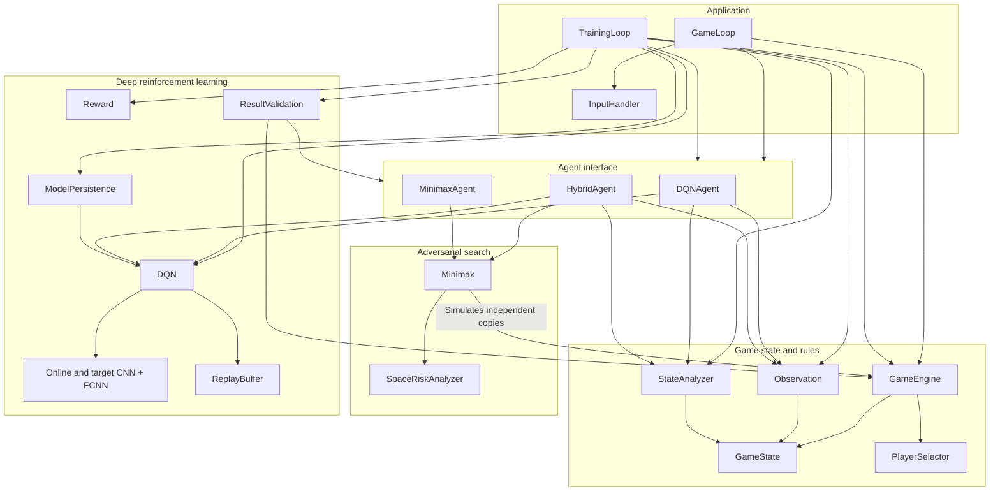

# Hybrid AI for Competitive Snake


*Illustrative hybrid match: two players grow every three rounds. An offensive
heuristic tries to cut off the opponent; six-ply Minimax checks survival and
rejects risky attacks. The animation shows which policy selected each move.*

## Overview

The playable C++ baseline uses `MinimaxAgent` with alpha-beta search. It scores
legal moves by exploring copies of the live game state, using territory and risk
estimates at the search horizon. The executable requires no model weights or
external C++ libraries and speaks the [INSAlgo Snake Competition protocol](https://github.com/INSAlgo/Concours-Snake).

The refactor has reached checkpoint 2 and completed standalone DQN integration.
Neural and hybrid agents, model persistence, training, and parameter optimization
are later stages of the target architecture.

---

## Architecture

The diagram below summarizes the target architecture for the refactoring.
The complete class interfaces, ownership relationships and behavioral contracts
are defined in [ClassDiagram.puml](ClassDiagram.puml).
Arrows show component dependencies.



- **GameEngine** owns the authoritative `GameState` and applies movement,
  collisions, growth, deaths and turn scheduling. Search uses copied states and
  the same transition rules as real play.
- **Observation and StateAnalyzer** transform a state into board channels and
  ordered numerical features. `EncodedState` groups these inputs with the legal
  action mask; `Transition` stores a learning experience.
- **Agents** share a `selectAction` interface. `DQNAgent` uses learned Q-values,
  `MinimaxAgent` uses search scores, and `HybridAgent` combines their normalized
  scores over legal actions using `(1 - lambda) * minimaxScore + lambda * qValue`.
- **DQN** owns online and target networks plus its replay buffer. CNN features
  pass through global average pooling and are combined with extra features before
  the FCNN produces four action values.
- **TrainingLoop** orchestrates episodes, rewards, replay training, target-network
  updates, model persistence and validation. Agents borrow the learner's DQN.

---

## Project Structure

```
├── main.cpp                # Competition protocol loop
├── snake.py                # Local competition runner
├── src/
│   ├── Agent/              # Action-selection interface and policies
│   ├── GameEngine/         # Rules, input and observation encoding
│   ├── Minimax/            # Alpha-beta search and spatial risk analysis
│   ├── DQN/                # Neural networks and learning components
│   ├── Structs.h           # Shared data structures
│   └── Utils.h             # Shared helpers
└── tests/                  # C++ component and executable tests
```

---

## Game State Representation

`Observation::encode(state, perspective)` and
`StateAnalyzer::computeExtraFeatures(state, perspective)` consume a valid engine
snapshot and return owned values. Neither component retains or mutates a state.
Player IDs are `1..N`; the perspective is explicit and need not be the scheduled
player. Legal-action masks come from the engine snapshot.

### Board State

Layout is `[channel][y][x]`, with **4*N + 1 channels**.
Player slot zero is the perspective player. The remaining slots follow ascending
player ID, excluding that player. Each player keeps its own channels, including
when dead.

| Channel within player slot `k` | Value |
| --- | --- |
| `4*k` | Head |
| `4*k + 1` | Interior body |
| `4*k + 2` | Tail |
| `4*k + 3` | Segment order: `(index from head + 1) / (W*H)`; zero for absent cells |
| Final channel `4*N` | Unoccupied cell (not reachability) |

A one-segment snake is both head and tail. Segment order preserves the complete
snake path, including which segment becomes the next tail. Dead bodies remain
occupied. The normalized head-coordinate channels have been removed.

### Extracted Features

Extra-feature schema 2 has a **required prefix**, followed by optional derived
features. The required prefix cannot be disabled through `FeatureSelection`:

| Block | Values, in order | Size |
| --- | --- | --- |
| Rules and time | W, H, M, round % M, absolute round, currentPlayer, perspective | 7 |
| Player slots | Player ID, alive flag, in the same own-first order as board channels | 2*N |

Rules, IDs and time are supplied as raw numerical values, without clipping.
This preserves distinctions between late rounds even after the optional progress
estimate saturates. Player count is fixed per model and recoverable from its
layout. Dead players retain their ID and have alive = 0.

Optional groups are appended in this order:

| Selection flag | Values | Size |
| --- | --- | --- |
| `distances` | Per opponent: own head to opponent segments min/max/mean, then opponent head to own segments min/max/mean | 6*(N - 1) |
| `snakeSize` | Own snake length / (W*H) | 1 |
| `gameProgress` | Capped elapsed scheduled slots / heuristic turn budget | 1 |
| `mobility`, `wallProximity` | Per opponent: enabled legal-action count / 4, then enabled wall/corner proximity | Up to 2*(N - 1) |

Opponent metrics follow ascending ID excluding the perspective player; dead
opponents retain zero-filled metric slots. With every group enabled there are
`10*N + 1` values: **21 for two players**. With all groups disabled only the
`7 + 2*N` required values remain. Use
`StateAnalyzer::getFeatureCount(N, selection)` rather than a hard-coded size.

### Comparing Feature Groups

Use the same selection for every observation supplied to a model:

```cpp
FeatureSelection selection;
selection.distances = false;
selection.wallProximity = false;

auto features = analyzer.computeExtraFeatures(state, perspective, selection);
int featureCount = StateAnalyzer::getFeatureCount(state.config.N, selection);

ModelConfig config;
config.numPlayers = state.config.N;
config.features = selection;
config.extraFeatureCount = featureCount;
```

All flags default to true. To test only required inputs, use
`FeatureSelection{false, false, false, false, false}`. The flags select groups,
not individual distance statistics. Changing selection changes input positions
and potentially their count: train a separate model for each selection. Compare
runs using the same opponents, boards, evaluation conditions and training budget.

### Formulas and State Sufficiency

- Distances retain Euclidean normalization `sqrt(W*W + H*H)` and include all
  stored segments, including head and tail.
- Growth uses the authoritative round and the fixed player schedule, including
  dead slots. `round % M == 0` identifies a growth round.
- Elapsed slots are `round*N + currentPlayer - 1`. The optional progress heuristic
  uses `W*H*M`, multiplied by 0.8 when M > 1, and clamps the ratio to `[0,1]`.
  It does not determine termination or replace the required absolute round.
- Wall/corner proximity adds 0.5 for each axis within its outer quarter, then
  averages that weight with `1 - nearestWallDistance/(max(W,H)/2)` and clamps to
  `[0,1]`.
- Action histories remain in engine snapshots for diagnostics but are no longer
  model features. The legacy reward entropy penalty and running reward statistics
  have been removed, as has the unused hybrid-policy history parameter.

For valid engine snapshots and ordinary supported board sizes, these inputs
retain the geometry, identities and timing needed for game transitions.

### Mention on markov state
Since the opponent’s identity is hidden, the board alone does not necessarily
contain all the information useful for predicting its next action. That makes
the learner’s problem partially observable. This is the only limit for the state
to be markov.

---

## Components

## SpaceRiskAnalyzer
SpaceRiskAnalyzer is a spatial risk assessment system for grid-based games that provides tools to evaluate spatial risks, 
available areas, and movement dangers in competitive grid environments like Snake.

### Features
- **Risk Heatmap Generation**: Calculates risk levels across the game grid based on how quickly different players can reach each cell
- **Space Accessibility Analysis**: Determines available movement space for each player using multi-source flood fill
- **Directional Risk Assessment**: Evaluates the danger of moving in specific directions
- **Efficient Caching**: Avoids redundant calculations by caching precomputed data

### Core Algorithms
- **Reach Timing Computation**: Uses BFS to calculate how many steps it takes each player to reach every cell
- **Multi-source Flood Fill**: Determines accessible areas and contested regions
- **Exponential Decay**: Applies decay to risk factors based on distance for more accurate risk assessment


### Minimax Algorithm
A classical AI approach designed for strategic defense.

- **Highlights:**
  - Alpha-beta pruning for efficient state search.
  - Evaluation functions that integrate spatial risk analysis.
  - Adaptive to varying board sizes and dynamic game conditions.

### Neural Network AI
Deep reinforcement learning approach:
- **CNN** uses two padded 3×3 ReLU convolutions by default, with 16 and 32 output channels. Global average pooling gives one value per final channel.
- **Feature fusion** appends the selected analytical features to those channel means in their encoded order.
- **FCNN** defaults to ReLU layers of width 64 and 32, followed by four linear outputs in left, up, right, down order. Set `ModelConfig::convolutionLayers` and `ModelConfig::denseHiddenSizes` to change the layer shapes.
- **ReplayBuffer**: Implements experience replay for stable learning
- Training mechanisms with decay exploration rates


## Usage

Build `AI` with GNU Make and a C++17 compiler, then pass it to the local match
runner. For example, play both seats on a 6×4 board with growth every round.

```sh
make
python3 snake.py ./AI ./AI -g 6 4 -G 1
```

`AI` reads setup and opponent events from standard input and flushes one
direction to standard output per playable turn. It uses the default Minimax
configuration of eight scheduled slots, including the root action, and breaks
score ties in `Action` enum order. A trapped player exits without emitting a
direction, which the local runner reports as a timeout. Opponent deaths consume
their scheduled slot, including when a collision also sends a move notification.

```sh
make test TEST="--checkpoint 2"
```

Checkpoint 2 runs the engine, protocol, observation, state analysis, spatial
analysis and Minimax suites. The game-loop suite drives the built `AI` with
recorded protocol input, including a position with a unique winning move.


## todo:
- Connect the neural and hybrid agents to DQN.
- finish optimise.cpp
- finish train.cpp

- optimise terminal state detection in Minimax (multiple methods and don't use the alive state)
- optimise Minimax using transition table

- 📈 performance benchmark
| Metric                | Minimax Only | DQN Only | Hybrid AI |
|-----------------------|--------------|----------|-----------|
| Win Rate (1v1)        | 0%           | 0%       | **0%**    |
| Decisions/sec         | 0            | 0        | 0         |
| Training Convergence  | N/A          | 0h       | 0h        |
