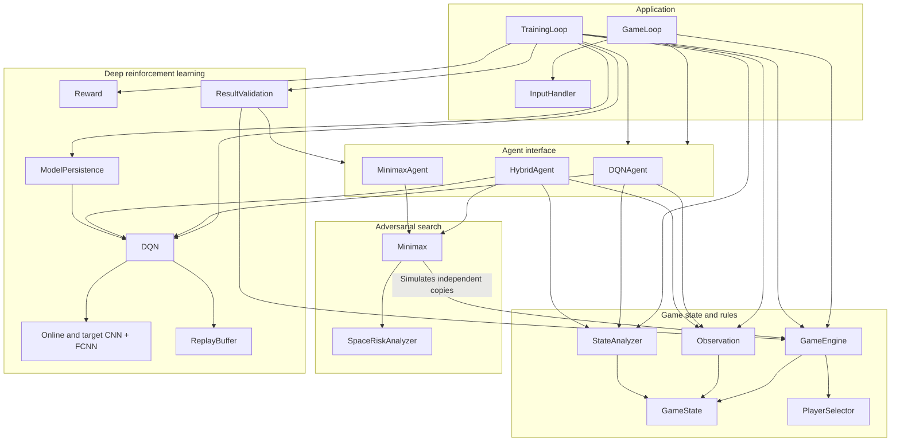

# Hybrid AI for Competitive Snake


*Illustrative hybrid match: two players grow every three rounds. An offensive
heuristic tries to cut off the opponent; six-ply Minimax checks survival and
rejects risky attacks. The animation shows which policy selected each move.

## Overview


This is an advanced AI system for playing a multiplayer Snake games to participate in the [INSAlgo Snake Competition](https://github.com/INSAlgo/Concours-Snake)

The project implements a combination of 2 AI approaches in C++ without using any external libraries:
1. **Minimax Algorithm with Alpha-Beta Pruning**  
   *Focus: Defense & Survival*
  - **Self-preservation:** Avoids self-blocking by ensuring safe moves.
  - **Defensive Search:** Evaluates moves to trap or force the opponent into a dangerous position.
  - **Dynamic Evaluation:** Adjusts search based on board size and game state.

2. **Deep Q-Learning (DQN) with Convolutional & Fully Connected Neural Networks**  
   *Focus: Offense & Adaptability*
  - **Risk-Taking:** Learns to exploit opportunities and take calculated risks.
  - **Adaptive Strategy:** Adapts to opponent behavior and varying map sizes.
  - **Feature Extraction:** Uses a CNN to visually process the game board and an FCNN to make decisions based on combined features.

---

## Key Features

- **Hybrid AI Strategies:**
  - **Minimax with Alpha-Beta Pruning:** Guarantees defensive play and trap-setting.
  - **Deep Q-Network (DQN):** Combines CNN for board analysis with FCNN for decision making.
  - **Hybrid Integration:** Leverages the strengths of both approaches for optimal performance.

- **Advanced Spatial Risk Analysis:**
  - Dynamic risk heatmaps and multi-source flood fill algorithms for area control.
  - Temporal-spatial risk assessment to evaluate movement dangers.

- **Sophisticated Reward System:**
  - Legacy rewards based on outcomes, survival and opponent constraints; integration is being refactored.
  - Tailored metrics that adjust for board size and dynamic game scenarios.

- **Robust Training & Validation Tools:**
  - Experience replay buffer for stable training.
  - Tools for saving/loading models and performance analytics.
  - Integrated validation routines to analyze victories, survival turns, rewards, Q-value consistency, and action entropy.

---

## Architecture

The diagram below summarizes the target architecture for the refactoring.
The complete class interfaces, ownership relationships and behavioral contracts
are defined in [ClassDiagram.puml](ClassDiagram.puml).
Arrows show component dependencies.



- **GameEngine** owns the authoritative `GameState` and applies movement,
  collisions, growth, deaths and turn scheduling. Search uses copied states and
  the same transition rules as real play.
- **Observation and StateAnalyzer** transform a state into board channels and
  ordered numerical features. `EncodedState` groups these inputs with the legal
  action mask; `Transition` stores a learning experience.
- **Agents** share a `selectAction` interface. `DQNAgent` uses learned Q-values,
  `MinimaxAgent` uses search scores, and `HybridAgent` combines their normalized
  scores over legal actions using `(1 - lambda) * minimaxScore + lambda * qValue`.
- **DQN** owns online and target networks plus its replay buffer. CNN features
  pass through global average pooling and are combined with extra features before
  the FCNN produces four action values.
- **TrainingLoop** orchestrates episodes, rewards, replay training, target-network
  updates, model persistence and validation. Agents borrow the learner's DQN.

---

## Project Structure

```
├── include/
│   ├── CNN.h               # Convolutional neural network
│   ├── FCNN.h              # Fully connected neural network
│   ├── Minimax.h           # Minimax algorithm with alpha-beta pruning
│   ├── NNAI.h              # Combination of CNN and FCNN for AI
│   ├── ReplayBuffer.h      # Replay buffer for deep Q-Learning
│   ├── SpaceRiskAnalyzer.h # Spatial risk assessment
│   ├── Structs.h           # Data structures
│   └── Utils.h             # Utility functions
├── src/
│   ├── CNN.cpp               # Implementation of a convolutional neural network
│   ├── FCNN.cpp              # Implementation of a fully connected neural network
│   ├── Minimax.cpp           # Implementation of a minimax algorithm with alpha-beta pruning
│   ├── NNAI.cpp              # Implementation of the combination of CNN and FCNN for AI
│   ├── ReplayBuffer.cpp      # Implementation of a replay buffer for deep Q-Learning
│   ├── SpaceRiskAnalyzer.cpp # Implementation of a spatial risk assessment class
│   └── Reward.cpp             # Implementation of utility functions
```

---

## Game State Representation

`Observation::encode(state, perspective)` and
`StateAnalyzer::computeExtraFeatures(state, perspective)` consume a valid engine
snapshot and return owned values. Neither component retains or mutates a state.
Player IDs are `1..N`; the perspective is explicit and need not be the scheduled
player. Legal-action masks come from the engine snapshot.

### Board State

Layout is `[channel][y][x]`, with **4*N + 1 channels**.
Player slot zero is the perspective player. The remaining slots follow ascending
player ID, excluding that player. Each player keeps its own channels, including
when dead.

| Channel within player slot `k` | Value |
| --- | --- |
| `4*k` | Head |
| `4*k + 1` | Interior body |
| `4*k + 2` | Tail |
| `4*k + 3` | Segment order: `(index from head + 1) / (W*H)`; zero for absent cells |
| Final channel `4*N` | Unoccupied cell (not reachability) |

A one-segment snake is both head and tail. Segment order preserves the complete
snake path, including which segment becomes the next tail. Dead bodies remain
occupied. The normalized head-coordinate channels have been removed.

### Extracted Features

Extra-feature schema 2 has a **required prefix**, followed by optional derived
features. The required prefix cannot be disabled through `FeatureSelection`:

| Block | Values, in order | Size |
| --- | --- | --- |
| Rules and time | W, H, M, round % M, absolute round, currentPlayer, perspective | 7 |
| Player slots | Player ID, alive flag, in the same own-first order as board channels | 2*N |

Rules, IDs and time are supplied as raw numerical values, without clipping.
This preserves distinctions between late rounds even after the optional progress
estimate saturates. Player count is fixed per model and recoverable from its
layout. Dead players retain their ID and have alive = 0.

Optional groups are appended in this order:

| Selection flag | Values | Size |
| --- | --- | --- |
| `distances` | Per opponent: own head to opponent segments min/max/mean, then opponent head to own segments min/max/mean | 6*(N - 1) |
| `snakeSize` | Own snake length / (W*H) | 1 |
| `gameProgress` | Capped elapsed scheduled slots / heuristic turn budget | 1 |
| `mobility`, `wallProximity` | Per opponent: enabled legal-action count / 4, then enabled wall/corner proximity | Up to 2*(N - 1) |

Opponent metrics follow ascending ID excluding the perspective player; dead
opponents retain zero-filled metric slots. With every group enabled there are
`10*N + 1` values: **21 for two players**. With all groups disabled only the
`7 + 2*N` required values remain. Use
`StateAnalyzer::getFeatureCount(N, selection)` rather than a hard-coded size.

### Comparing Feature Groups

Use the same selection for every observation supplied to a model:

```cpp
FeatureSelection selection;
selection.distances = false;
selection.wallProximity = false;

auto features = analyzer.computeExtraFeatures(state, perspective, selection);
int featureCount = StateAnalyzer::getFeatureCount(state.config.N, selection);

ModelConfig config;
config.numPlayers = state.config.N;
config.features = selection;
config.extraFeatureCount = featureCount;
```

All flags default to true. To test only required inputs, use
`FeatureSelection{false, false, false, false, false}`. The flags select groups,
not individual distance statistics. Changing selection changes input positions
and potentially their count: train a separate model for each selection. Compare
runs using the same opponents, boards, evaluation conditions and training budget.

### Formulas and State Sufficiency

- Distances retain Euclidean normalization `sqrt(W*W + H*H)` and include all
  stored segments, including head and tail.
- Growth uses the authoritative round and the fixed player schedule, including
  dead slots. `round % M == 0` identifies a growth round.
- Elapsed slots are `round*N + currentPlayer - 1`. The optional progress heuristic
  uses `W*H*M`, multiplied by 0.8 when M > 1, and clamps the ratio to `[0,1]`.
  It does not determine termination or replace the required absolute round.
- Wall/corner proximity adds 0.5 for each axis within its outer quarter, then
  averages that weight with `1 - nearestWallDistance/(max(W,H)/2)` and clamps to
  `[0,1]`.
- Action histories remain in engine snapshots for diagnostics but are no longer
  model features. The legacy reward entropy penalty and running reward statistics
  have been removed, as has the unused hybrid-policy history parameter.

For valid engine snapshots and ordinary supported board sizes, these inputs
retain the geometry, identities and timing needed for game transitions.

### Mention on markov state
Since the opponent’s identity is hidden, the board alone does not necessarily
contain all the information useful for predicting its next action. That makes
the learner’s problem partially observable. This is the only limit for the state
to be markov.

---

## Components

## SpaceRiskAnalyzer
SpaceRiskAnalyzer is a spatial risk assessment system for grid-based games that provides tools to evaluate spatial risks, 
available areas, and movement dangers in competitive grid environments like Snake.

### Features
- **Risk Heatmap Generation**: Calculates risk levels across the game grid based on how quickly different players can reach each cell
- **Space Accessibility Analysis**: Determines available movement space for each player using multi-source flood fill
- **Directional Risk Assessment**: Evaluates the danger of moving in specific directions
- **Efficient Caching**: Avoids redundant calculations by caching precomputed data

### Core Algorithms
- **Reach Timing Computation**: Uses BFS to calculate how many steps it takes each player to reach every cell
- **Multi-source Flood Fill**: Determines accessible areas and contested regions
- **Exponential Decay**: Applies decay to risk factors based on distance for more accurate risk assessment


### Minimax Algorithm
A classical AI approach designed for strategic defense.

- **Highlights:**
  - Alpha-beta pruning for efficient state search.
  - Evaluation functions that integrate spatial risk analysis.
  - Adaptive to varying board sizes and dynamic game conditions.

### Neural Network AI
Deep reinforcement learning approach:
- **CNN**: Processes the board state visually : 3x3 conv → maxpool → 3x3 conv
- **Feature Fusion**: Concatenates spatial + analytic features
- **FCNN**: Makes decisions based on extracted features and the output of the CNN : 64 → 32 → 4 FC layers with ReLU except the last one which is a linear layer
- **ReplayBuffer**: Implements experience replay for stable learning
- Training mechanisms with decay exploration rates


## Usage
The main.cpp file provide 3 different main functions:
- `gameMain` to play a game with the combination of both AI
- `trainingMain` to train the neural network AI
- `optimiseMain` to optimise the Minimax parameters


## todo:
- finish main.cpp
- finish optimise.cpp
- finish train.cpp

- optimise terminal state detection in Minimax (multiple methods and don't use the alive state)
- optimise Minimax using transition table

- 📈 performance benchmark
| Metric                | Minimax Only | DQN Only | Hybrid AI |
|-----------------------|--------------|----------|-----------|
| Win Rate (1v1)        | 0%           | 0%       | **0%**    |
| Decisions/sec         | 0            | 0        | 0         |
| Training Convergence  | N/A          | 0h       | 0h        |
