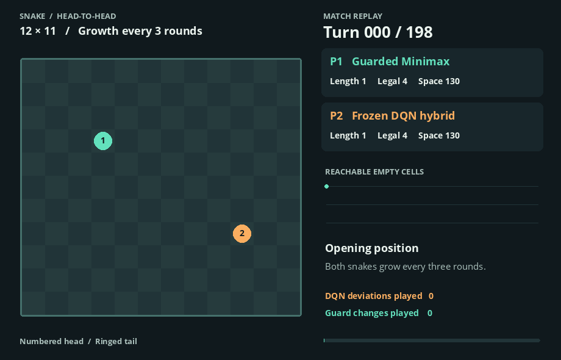
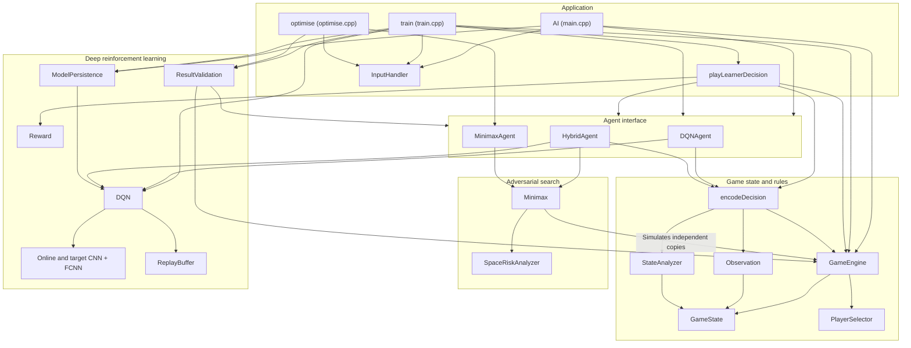

# Hybrid AI for Competitive Snake



*Illustrative match using hand-coded policies. Two players grow every three
rounds, and a six-ply Minimax search checks the offensive heuristic's proposed
moves.*

## Overview

The C++ player speaks the [INSAlgo Snake Competition protocol](https://github.com/INSAlgo/Concours-Snake).
Its default Minimax agent scores legal moves with alpha-beta search and territory
and risk estimates. The player also supports DQN and Hybrid policies backed by
checkpoints produced by the training executable.

---

## Architecture

The diagram shows the main dependencies of the three executables.
[ClassDiagram.puml](ClassDiagram.puml) describes their interfaces, ownership and
behavioral contracts.



- **GameEngine** owns the authoritative `GameState` and applies movement,
  collisions, growth, deaths and turn scheduling. Search uses copied states and
  the same transition rules as real play.
- **Observation and StateAnalyzer** transform a state into board channels and
  ordered numerical features. `EncodedState` groups these inputs with the legal
  action mask; `Transition` stores a learning experience.
- **Agents** share a `selectAction` interface for the scheduled player.
  `DQNAgent` uses learned Q-values, and `MinimaxAgent` uses search scores.
  `HybridAgent` scales each scorer independently to `[0, 1]` using its legal
  minimum and maximum, maps constant scores to zero, and maximizes
  `(1 - lambda) * minimaxScore + lambda * qValue`. Score ties follow Action enum
  order. Both neural agents borrow the training learner and use its feature
  selection. With exploration enabled, the learner's current epsilon is the
  probability of choosing a uniformly random legal action.
- **DQN** owns online and target networks plus its replay buffer. CNN features
  pass through global average pooling and are combined with extra features before
  the FCNN produces four action values.
- **train** owns the learner, runs episodes and schedules replay updates,
  target synchronization, saves and validation. `playLearnerDecision` executes
  the learner action and intervening opponent turns to produce a transition.
- **optimise** evaluates Minimax configurations on caller-supplied setups and
  writes the winning weights and depth.

---

## Project Structure

```
├── main.cpp                # Competition protocol loop
├── train.cpp               # Neural training, checkpointing and evaluation
├── optimise.cpp            # Minimax parameter search
├── snake.py                # Local competition runner
├── src/
│   ├── Agent/              # Action-selection interface and policies
│   ├── GameEngine/         # Rules, input and observation encoding
│   ├── Minimax/            # Alpha-beta search and spatial risk analysis
│   ├── DQN/                # Neural networks and learning components
│   ├── TrainingLoop.h/.cpp  # Decision-to-decision transitions
│   ├── Structs.h           # Shared data structures
│   └── Utils.h             # Shared helpers
├── tests/                  # C++ component and executable tests
└── tools/visualizer/       # Browser viewer for live and recorded matches
```

---

## Game State Representation

`Observation::encode(state, perspective)` and
`StateAnalyzer::computeExtraFeatures(state, perspective)` consume a valid engine
snapshot and return owned values. Neither component retains or mutates a state.
Player IDs are `1..N`; the perspective is explicit and need not be the scheduled
player. Legal-action masks come from the engine snapshot.

### Board State

Board schema 2 uses `[channel][y][x]`, with **4*N + 1 channels**.
Player slot zero is the perspective player. The remaining slots follow ascending
player ID, excluding that player. Each player keeps its own channels, including
when dead.

| Channel within player slot `k` | Value |
| --- | --- |
| `4*k` | Head |
| `4*k + 1` | Interior body |
| `4*k + 2` | Tail |
| `4*k + 3` | Segment order: `(index from head + 1) / (W*H)`; zero for absent cells |
| Final channel `4*N` | Unoccupied cell (not reachability) |

A one-segment snake is both head and tail. Segment order preserves the complete
snake path, including which segment becomes the next tail. Dead bodies remain
occupied.

### Extracted Features

Extra-feature schema 2 has a **required prefix**, followed by optional derived
features. The required prefix cannot be disabled through `FeatureSelection`:

| Block | Values, in order | Size |
| --- | --- | --- |
| Rules and time | W, H, M, round % M, absolute round, currentPlayer, perspective | 7 |
| Player slots | Player ID, alive flag, in the same own-first order as board channels | 2*N |

Rules, IDs and time are supplied as raw numerical values, without clipping.
This preserves distinctions between late rounds even after the optional progress
estimate saturates. Player count is fixed per model and recoverable from its
layout. Dead players retain their ID and have alive = 0.

Optional groups are appended in this order:

| Selection flag | Values | Size |
| --- | --- | --- |
| `distances` | Per opponent: own head to opponent segments min/max/mean, then opponent head to own segments min/max/mean | 6*(N - 1) |
| `snakeSize` | Own snake length / (W*H) | 1 |
| `gameProgress` | Capped elapsed scheduled slots / heuristic turn budget | 1 |
| `mobility`, `wallProximity` | Per opponent: enabled legal-action count / 4, then enabled wall/corner proximity | Up to 2*(N - 1) |

Opponent metrics follow ascending ID excluding the perspective player; dead
opponents retain zero-filled metric slots. With every group enabled there are
`10*N + 1` values: **21 for two players**. With all groups disabled only the
`7 + 2*N` required values remain. Use
`StateAnalyzer::getFeatureCount(N, selection)` rather than a hard-coded size.

### Comparing Feature Groups

Use the same selection for every observation supplied to a model:

```cpp
FeatureSelection selection;
selection.distances = false;
selection.wallProximity = false;

auto features = analyzer.computeExtraFeatures(state, perspective, selection);
int featureCount = StateAnalyzer::getFeatureCount(state.config.N, selection);

ModelConfig config;
config.numPlayers = state.config.N;
config.features = selection;
config.extraFeatureCount = featureCount;
```

All flags default to true. To test only required inputs, use
`FeatureSelection{false, false, false, false, false}`. The flags select groups,
not individual distance statistics. Changing selection changes input positions
and potentially their count: train a separate model for each selection. Compare
runs using the same opponents, boards, evaluation conditions and training budget.

### Formulas and State Sufficiency

- Distances retain Euclidean normalization `sqrt(W*W + H*H)` and include all
  stored segments, including head and tail.
- Growth uses the authoritative round and the fixed player schedule, including
  dead slots. `round % M == 0` identifies a growth round.
- Elapsed slots are `round*N + currentPlayer - 1`. The optional progress heuristic
  uses `W*H*M`, multiplied by 0.8 when M > 1, and clamps the ratio to `[0,1]`.
  It does not determine termination or replace the required absolute round.
- Wall/corner proximity adds 0.5 for each axis within its outer quarter, then
  averages that weight with `1 - nearestWallDistance/(max(W,H)/2)` and clamps to
  `[0,1]`.
- Engine snapshots keep up to five recent actions per player for diagnostics.

For valid engine snapshots and ordinary supported board sizes, these inputs
retain the geometry, identities and timing needed for game transitions.

The encoders omit opponent policy and internal agent state. Those can affect
future actions even when the encoded board and turn context are identical.

## Components

- **SpaceRiskAnalyzer** runs breadth-first search per living player on the
  current occupancy grid. Shortest move distances assign territory, with ties
  treated as contested. Scheduled arrivals within the lookahead horizon feed the
  risk heatmap, with exponential decay by move distance. Each analysis computes
  paths from its own snapshot and reuses a decay table across calls.
- **Minimax** uses alpha-beta search on engine successors. The root player
  maximizes its score and every opponent minimizes it. Nonterminal leaves use
  territory, block risk, directional heat risk and snake length. Each legal
  root move gets a full search window, and terminal outcomes take precedence
  over heuristic scores.
- **DQN** defaults to two padded 3×3 ReLU convolutions with 16 and 32 channels.
  Global average pooling gives one value per output channel. The FCNN reads
  those values followed by the selected extra features, uses ReLU layers of
  width 64 and 32, and outputs four linear Q-values in left, up, right, down
  order. `ModelConfig::convolutionLayers` and `ModelConfig::denseHiddenSizes`
  set the layer shapes. Training samples replay without replacement and
  bootstraps from the target networks over legal next actions for nonterminal
  transitions.

## Usage

Build `AI`, `train` and `optimise` with GNU Make and a C++17 compiler on a
POSIX system. The default target is `all`. Individual targets build their named
executable. `make debug` cleans the build and rebuilds `AI` with debug symbols.
Use `make clean` before switching back to the normal build.

Pass `AI` to the Python 3 match runner to play both seats on a 6×4 board with
growth every round.

```sh
make
python3 snake.py ./AI ./AI -g 6 4 -G 1
```

`AI` reads setup and opponent events from standard input and flushes one
direction to standard output per playable turn. It uses the default Minimax
configuration of eight scheduled slots, including the root action, and breaks
score ties in `Action` enum order. A trapped player exits without emitting a
direction, which the local runner reports as a timeout. Opponent deaths consume
their scheduled slot, including when a collision also sends a move notification.
The setup uses a one-based controlled seat and zero-based origins. Event player
IDs are zero-based on the wire. See the [match viewer guide](tools/visualizer/README.md)
for live and recorded browser views.

To use a checkpoint, start `AI` with one of these argument lists and supply the
same competition input stream. Neural play uses greedy actions with exploration
disabled. The checkpoint must match the CLI model configuration for the number
of players in the match. Play and training use all feature groups and the default
network shapes. Checkpoint loading checks the model configuration and both input
schema versions before restoring weights and training state.

```sh
./AI dqn model.model
./AI hybrid model.model 0.5
```

`0.5` gives equal weight to the normalized Minimax and neural scores. Hybrid
weights range from `0` for Minimax scores to `1` for neural scores.

### Minimax override margin

Use `./AI hybrid-gap CHECKPOINT MARGIN --minimax-params FILE` to let the DQN
choose among legal moves within MARGIN raw search-score units of the best
Minimax move. Zero permits exact search ties. Search retains its choice on a
proven win or when all moves lose within its horizon, and excludes proven
losses when an alternative exists. The existing weighted hybrid is available
through `./AI hybrid CHECKPOINT LAMBDA`.

### Training and validation

`training.txt` contains one setup in competition format. It gives the board
width and height, growth period, player count and one-based learner seat,
followed by each seat's zero-based origin. For example:

```text
4 1
1
2 1
0 0
3 0
```

`validation.txt` contains one or more setups in the same format, concatenated
without event lines. It may use different boards, origins and learner seats
while keeping the player's model input compatible by using the same number of
players. For example, use two held-out 3×1 setups with origins `0 0` and `2 0`
and swap the learner seat between them. Minimax plays all other seats in both
training and validation. Start a fresh run with a new checkpoint path.

```sh
./train 10 training.txt validation.txt model.model
./train 10 training.txt validation.txt model.model --resume
./train 10 training.txt validation.txt hybrid.model --hybrid 0.5
```

For CPU tensor training, build the optional C++ LibTorch executable with a
C++17-compatible LibTorch installation. `TORCH_ROOT` contains its `include/`
and `lib/` directories. The desktop uses the torch package in its training
Python environment as that installation.

```sh
export TORCH_ROOT=$(python -c 'import torch; print(torch.__path__[0])')
make -j4 train-torch CXXFLAGS="-std=c++17 -O2 -DNDEBUG"
./train-torch 10 training.txt validation.txt model.model --torch-threads 4
```

Four intra-operation CPU threads are the default. The trainer batches boards
of the same shape for convolution and uses the online network for acting.
Both trainers and the standalone C++ player read the same checkpoint format.
Use `--resume` to continue training a checkpoint with either trainer.

Each episode starts from the training setup. The learner explores during
training and updates replay once per executed learner decision. A transition
includes the intervening opponent turns and ends at the next learner decision
or termination. Validation disables exploration and reports wins, win rate and
mean survival turns over the supplied matches.

Defaults are batch size 32, learning rate `0.00001`, target synchronization
every 100 updates, and saving and evaluation every 10 episodes. Set these with
`--batch-size N`, `--learning-rate RATE`, `--target-every UPDATES`,
`--save-every EPISODES` and `--evaluate-every EPISODES`. Saving and evaluation
also run after the final episode. `--seed N` sets the initial model and
training RNG seed, which defaults to 5489 for a fresh run.

`--resume` restores the learner, target networks, replay, exploration and RNG
state, and the absolute update counter. It starts a fresh episode, and the
save and evaluation intervals count episodes in the current invocation. Pass
the same training settings when continuing a run.

### Terminal-reward DQN pilot

From the project root, build and run the separate experiment executable:

```sh
make build/pilot
build/pilot 25 starts.txt validation.txt experiments/terminal-pilot/pilot.conf runs/pilot
build/pilot 25 starts.txt validation.txt experiments/terminal-pilot/pilot.conf runs/pilot --resume runs/pilot/episode-25
```

For LibTorch use the same arguments with `build/pilot-torch` after building
`make build/pilot-torch TORCH_ROOT="$TORCH_ROOT"`. The episode count is the
number of additional episodes. The config file sets opponent weights, shallow
depth, tuned Minimax parameter file, exploration schedule and training settings.
Run from the project root to resolve relative parameter paths.

The runner samples a training layout, alternates seats, and evaluates against
the tuned opponent. It assigns +1 for a win, −1 for a loss and zero for
continuing play. Its exploration rate comes from the cumulative update count.
Use `--until-epsilon-floor` to stop at the end of the episode that reaches
the configured floor. Each episode checkpoint directory contains an ordinary
`model.model` for the player and a `pilot.state` for experiment resume.
Resume requires matching config, layout and Minimax parameter file contents.
Earlier experiment snapshots without the companion file remain playable.

### Minimax parameter optimization

Give `optimise` a file of competition setups in the validation format above.
Each setup specifies the candidate's seat, and the default Minimax agent
plays every other seat. Supply boards, origins and seats that reflect the
matches you want the optimizer to score.

```sh
./optimise validation.txt best_params.txt
./optimise validation.txt best_params.txt --population 4 --generations 3 --seed 17
```

The genetic search evaluates every candidate on the same setups and ranks them
by win rate. Mean survival turns are reported separately. The two highest-ranked
individuals carry over, and the remaining candidates inherit each field from one
of two uniformly sampled parents. The defaults are a population of 30, 50
generations and seed 5489. The population must be at least 3. Initial weights
use the legacy ranges and initial depths range from 6 to 10 scheduled slots.

The first line of the output file stores the weights in the order
`selfSpace oppSpace selfBlockRisk oppBlockRisk selfHeatRisk oppHeatRisk snakeLength`.
The second line gives the depth. The optimizer replaces the named output with
the winner after the search completes. Ties keep the first candidate to reach the
winning score.

```sh
./AI minimax --minimax-params best_params.txt
./AI hybrid model.model 0.5 --minimax-params best_params.txt
./train 10 training.txt validation.txt tuned.model --hybrid 0.5 --minimax-params best_params.txt
```

Play and training load the file once at startup. In training, the parameters
configure the Minimax opponents and the Minimax branch of Hybrid behavior and
evaluation. Play and training use the built-in defaults when the option is
omitted. When resuming tuned training, pass the same parameter file again.

## Tests

```sh
make test
make test TEST=optimise
make test TEST=--list
```

The permanent suites exercise the engine, encoders, search, neural gradients,
learning updates, agents and checkpoint persistence. Executable tests cover
competition protocol transcripts, training and resumption, DQN and Hybrid play,
and loading optimized Minimax parameters in play and training. See the
[testing guide](tests/README.md) for component coverage and CI behavior.

## Future work

- Profile Minimax terminal-state checks and assess a transposition table.
- Benchmark decision throughput, match outcomes and learning convergence.
